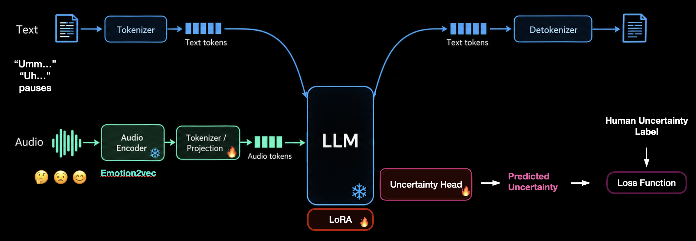
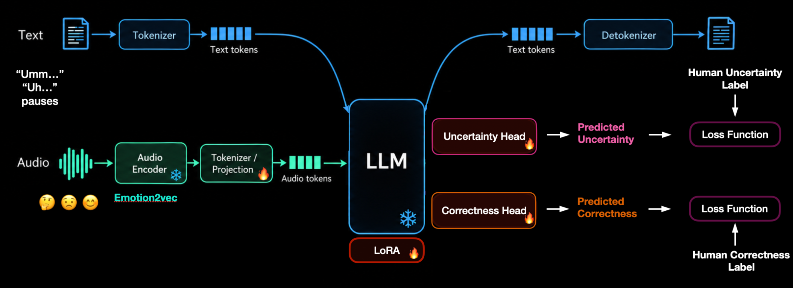
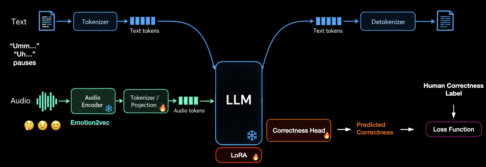

# State Benchmark (3×3, full run) — concise summary

Source log: `logs/state_benchmark_28764189.out` (Job `28764189`, full mode)

## 1) Objectives and model families

The benchmark trains 3 objective settings (model keys `A/B/C`) and evaluates each under 3 input modalities (`text_only`, `voice_only`, `voice_text`), for **9 total trained conditions**.

### Three model types:

- **A: Uncertainty Model (`uncertainty_only`)** — LLM with single Uncertainty Head; predicts learner uncertainty only.

- **B: Combined Model (`multitask_equal_weight`)** — LLM with dual heads (Uncertainty Head + Correctness Head); jointly predicts uncertainty + correctness with equal loss weight.

- **C: Correctness Model (`correctness_only`)** — LLM with single Correctness Head; predicts correctness only.

Model backbone details (shared across runs):
- Qwen with LoRA adapters (base weights frozen).
- Audio projector used when modality includes voice.
- Heads are objective-specific (uncertainty head and/or correctness head).

## 2) The 9 full benchmark conditions

| Objective | Text only | Voice only | Voice + text |
|---|---|---|---|
| `uncertainty_only` (A) | `uncertainty_only__text_only` | `uncertainty_only__voice_only` | `uncertainty_only__voice_text` |
| `multitask_equal_weight` (B) | `multitask_equal_weight__text_only` | `multitask_equal_weight__voice_only` | `multitask_equal_weight__voice_text` |
| `correctness_only` (C) | `correctness_only__text_only` | `correctness_only__voice_only` | `correctness_only__voice_text` |

Also reported: `majority_baseline` for each target.

## 3) Train/val/test split and data details

From the run log/code path used by this job:

- **Data used (full mode):** 1,745 accepted labeled answers from 55 learners.
- **Split unit:** learner-level split (no learner appears in more than one split).
- **Split rule:** 70/15/15 by learners via two-step stratified split by condition:
  - `train_test_split(..., test_size=0.30)` for train vs held-out,
  - then held-out split 50/50 into val and test.
- **Approx learner counts in this run:** ~38 train / ~8 val / ~9 test learners (exact from 55 under the above split math).
- **Class constraint:** each split is checked to contain both uncertainty classes.
- **Note:** answer counts differ per split because learners contribute different numbers of turns.

## 4) Test results (from this run), grouped by objective

### One concrete example: same input, outputs from A/B/C

Input example (`example_id=pslc02-c2_58_001`, from test set):
- **Question:** “To analyze this problem we will first describe the motion of the person and his keys while he is holding them. Then we will look at the motion of the person and his keys after he lets go of them. Let's begin by looking at the motion of the man and his keys while he is holding them. How does his velocity compare to that of his keys?”
- **Student transcript:** `i don't know`
- **Student audio:** same aligned audio segment for this example ID

Ground truth labels for this example:
- `uncertain = 1` (uncertain)
- `correct = 0` (incorrect)

Model outputs below are probabilities from the **voice+text** variant of each objective (decision threshold is 0.5):

| Objective model | Output probabilities | Predicted label(s) | Ground truth |
|---|---|---|---|
| A: `uncertainty_only__voice_text` | `p(uncertainty)=0.972168` | uncertain (`1`) | uncertain=`1` |
| B: `multitask_equal_weight__voice_text` | `p(uncertainty)=0.988770`, `p(correctness)=0.025177` | uncertain (`1`), incorrect (`0`) | uncertain=`1`, correct=`0` |
| C: `correctness_only__voice_text` | `p(correctness)=0.000664` | incorrect (`0`) | correct=`0` |

Interpretation:
- Objective **A** only predicts uncertainty.
- Objective **B** predicts both uncertainty and correctness.
- Objective **C** only predicts correctness.

### Objective A — `uncertainty_only` (predicts uncertainty only)

| Run ID | Target | Macro-F1 | Balanced accuracy |
|---|---|---:|---:|
| `uncertainty_only__text_only` | uncertainty | 0.700694 | 0.710585 |
| `uncertainty_only__voice_only` | uncertainty | 0.686229 | 0.690524 |
| `uncertainty_only__voice_text` | uncertainty | 0.696942 | 0.703730 |

### Objective B — `multitask_equal_weight` (predicts uncertainty + correctness)

| Run ID | Target | Macro-F1 | Balanced accuracy |
|---|---|---:|---:|
| `multitask_equal_weight__text_only` | uncertainty | 0.713937 | 0.715020 |
| `multitask_equal_weight__voice_only` | uncertainty | 0.679365 | 0.679536 |
| `multitask_equal_weight__voice_text` | uncertainty | **0.723263** | **0.724698** |
| `multitask_equal_weight__text_only` | correctness | 0.837377 | 0.865491 |
| `multitask_equal_weight__voice_only` | correctness | 0.728898 | 0.716839 |
| `multitask_equal_weight__voice_text` | correctness | **0.851538** | 0.859232 |

### Objective C — `correctness_only` (predicts correctness only)

| Run ID | Target | Macro-F1 | Balanced accuracy |
|---|---|---:|---:|
| `correctness_only__text_only` | correctness | 0.844720 | **0.869523** |
| `correctness_only__voice_only` | correctness | 0.712080 | 0.699898 |
| `correctness_only__voice_text` | correctness | **0.851538** | 0.859232 |

Reference baselines reported in the run:
- `majority_baseline` on uncertainty: macro-F1 `0.329787`, balanced accuracy `0.500000`.
- `majority_baseline` on correctness: macro-F1 `0.440497`, balanced accuracy `0.500000`.
